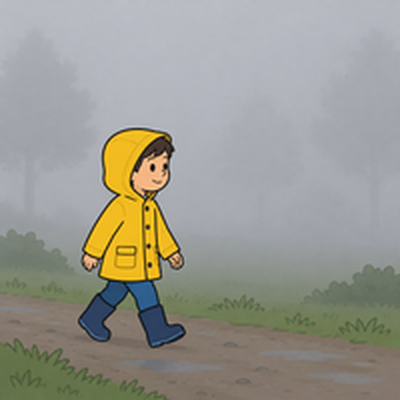

# Unit 1 The Great Outdoors — 第三回｜天氣 Let's Talk

姓名：________　座號：____　分數：____ / 100

## 一、聽力測驗

按「🔊 播放」聽句子（可重複聽），選出正確答案。

1. 🔊（老師播放）How's the weather going to be?
   (A) foggy　(B) cold　(C) hot　(D) cool
2. 🔊（老師播放）How do they feel?
   (A) excited　(B) sad　(C) tired　(D) angry
3. 🔊（老師播放）What does B say?
   (A) Yes, it is.　(B) B doesn't know.　(C) B hopes so.　(D) No, it isn't.
4. 🔊（老師播放）What does the newspaper say?
   (A) It's going to be warm.　(B) It's going to snow.　(C) It's going to be hot.　(D) It's going to be foggy.
5. 🔊（老師播放）Is tomorrow going to be cold?
   (A) No, it's going to be hot.　(B) No, it's going to be warm.　(C) Yes, it is.　(D) B doesn't know.

## 二、是非題

閱讀短文，判斷句子是 True（對）或 False（錯）。

> Mia is talking with her friend on the phone. They are going to go camping tomorrow. Mia is really excited. Her friend asks, "How's the weather going to be?" Mia says, "It's going to be cold." Her friend asks, "Is it going to rain?" Mia says, "I'm not sure. I hope not."

6. Mia and her friend are going to go camping.　（ T / F ）
7. Mia is not excited.　（ T / F ）
8. The weather is going to be cold.　（ T / F ）
9. Mia is sure it is going to rain.　（ T / F ）
10. They are talking face to face.　（ T / F ）

## 三、選擇題

選出最適合的答案。

11. How's the weather going to be tomorrow?  ____
   (A) Yes, I am.　(B) He needs a helmet.　(C) I'm going to go fishing.　(D) It's going to be foggy.
12. The weather is hot and dry. It is NOT ____.
   (A) humid　(B) sunny　(C) hot　(D) warm
13. It's snowing outside. It's very ____.
   (A) humid　(B) hot　(C) warm　(D) cold
14. I don't know. = I'm ____.
   (A) excited　(B) foggy　(C) not sure　(D) cold
15. A: Is it going to rain?  B: I ____ not.
   (A) am hope　(B) hopes　(C) hope　(D) hoping
16. How is the weather in the picture?  圖中天氣如何？
   
   (A) warm　(B) cold　(C) foggy　(D) hot
17. How is the weather in the picture?  圖中天氣如何？
   
   (A) cool　(B) humid　(C) foggy　(D) hot

## 四、文法測驗

選出文法正確的答案。

18. How's the weather ____ to be tomorrow?
   (A) go　(B) is going　(C) goes　(D) going
19. It's going ____ be cool.
   (A) for　(B) in　(C) at　(D) to
20. ____ it going to rain tomorrow?
   (A) Does　(B) Do　(C) Are　(D) Is
21. We ____ going to go camping tomorrow.
   (A) am　(B) be　(C) is　(D) are
22. It ____ going to snow.
   (A) am not　(B) isn't　(C) don't　(D) aren't

## 五、配合題

左邊的題目要配右邊哪一個？用下拉選單選出代號。

- (A) 有霧的
- (B) 寒冷的
- (C) 溫暖的
- (D) 潮濕的
- (E) 涼爽的

23. cool　（　）
24. cold　（　）
25. humid　（　）
26. foggy　（　）
27. warm　（　）

## 六、句子改寫

依照提示改寫句子，直接輸入完整句子（注意大小寫與標點可忽略）。

28. (改成疑問句) It is going to rain tomorrow.
   → ______________________________
29. (改成否定句) It's going to be cold.
   → ______________________________
30. (改成疑問句) The weather is going to be hot.
   → ______________________________
31. (改成否定句) We're going to go camping.
   → ______________________________
32. (用 tomorrow 改成未來式) It is foggy today.
   → ______________________________

## 七、句子重組

依序點選單字，排成正確的句子。

33. going / to / cold. / It's / be
   → ______________________________
34. going / it / to / rain? / Is
   → ______________________________
35. hope / I / not.
   → ______________________________
36. camping / We're / going / tomorrow. / to / go
   → ______________________________
37. the / weather / going / How's / tomorrow? / be / to
   → ______________________________

---

## 聽力稿（老師用）

1. A: How's the weather going to be? B: It's going to be hot.
2. A: We're going to go camping tomorrow. I'm really excited! B: Me, too!
3. A: Is it going to rain? B: I'm not sure.
4. The newspaper says it's going to snow tomorrow. Do you think we need our umbrellas?
5. A: Is it going to be cold tomorrow? B: Yes, it is. It's going to be very cold.

## 答案

**一、聽力測驗**　1. C　2. A　3. B　4. B　5. C

**二、是非題**　6. T　7. F　8. T　9. F　10. F

**三、選擇題**　11. D　12. A　13. D　14. C　15. C　16. B　17. C

**四、文法測驗**　18. D　19. D　20. D　21. D　22. B

**五、配合題**　23. E　24. B　25. D　26. A　27. C

**六、句子改寫**　
- 28. Is it going to rain tomorrow?
- 29. It's not going to be cold.
- 30. Is the weather going to be hot?
- 31. We're not going to go camping.
- 32. It is going to be foggy tomorrow.

**七、句子重組**　
- 33. It's going to be cold.
- 34. Is it going to rain?
- 35. I hope not.
- 36. We're going to go camping tomorrow.
- 37. How's the weather going to be tomorrow?
