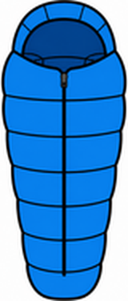
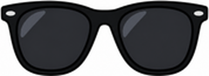

# Unit 1 The Great Outdoors — 第四回｜山上與海邊 What Do I Need?

姓名：________　座號：____　分數：____ / 100

## 一、聽力測驗

按「🔊 播放」聽句子（可重複聽），選出正確答案。

1. 🔊（老師播放）What does A need?
   (A) a swimsuit　(B) a flashlight　(C) a towel　(D) sunscreen
2. 🔊（老師播放）Where is A going?
   (A) the circus　(B) the mountains　(C) the beach　(D) school
3. 🔊（老師播放）What does she need?
   (A) a hat and sunglasses　(B) a tent and a sleeping bag　(C) a bat and a mitt　(D) a towel and a swimsuit
4. 🔊（老師播放）What do they need?
   (A) helmets　(B) hats　(C) towels　(D) tents
5. 🔊（老師播放）What does he need?
   (A) a bag　(B) a towel　(C) an umbrella　(D) a hat

## 二、是非題

閱讀短文，判斷句子是 True（對）或 False（錯）。

> Sam is going to go camping in the mountains. He needs a tent, a sleeping bag and a flashlight. Lily is going to go to the beach. She needs a swimsuit, a towel and sunscreen. Lily doesn't need a tent.

6. Sam is going to the beach.　（ T / F ）
7. Sam needs a flashlight.　（ T / F ）
8. Lily needs sunscreen.　（ T / F ）
9. Lily needs a tent.　（ T / F ）
10. Sam needs a swimsuit.　（ T / F ）

## 三、選擇題

選出最適合的答案。

11. You need a ____ when you go to bed in a tent.
   (A) sleeping bag　(B) towel　(C) bucket　(D) swimsuit
12. You need ____ to protect your eyes from the sun.
   (A) a flashlight　(B) a bat　(C) a tent　(D) sunglasses
13. You put ____ on your skin at the beach.
   (A) sunscreen　(B) a racket　(C) a helmet　(D) a mitt
14. You wear a ____ to swim.
   (A) tent　(B) swimsuit　(C) sleeping bag　(D) flashlight
15. A: I'm going to go to the mountains. What do I need?  B: ____
   (A) I need a flashlight.　(B) They need a hat.　(C) You need a flashlight.　(D) He needs a towel.
16. What is this?  這是什麼？
   
   (A) a tent　(B) a towel　(C) a swimsuit　(D) a sleeping bag
17. What is this?  這是什麼？
   
   (A) a hat　(B) a flashlight　(C) sunglasses　(D) sunscreen

## 四、文法測驗

選出文法正確的答案。

18. What does he ____?
   (A) needs　(B) need　(C) needed　(D) needing
19. She ____ a towel.
   (A) are need　(B) needing　(C) need　(D) needs
20. They ____ sunglasses.
   (A) needs　(B) needing　(C) is need　(D) need
21. Does she need a hat? No, she ____.
   (A) isn't　(B) aren't　(C) doesn't　(D) don't
22. I'm going ____ go to the beach.
   (A) for　(B) to　(C) on　(D) at

## 五、配合題

左邊的題目要配右邊哪一個？用下拉選單選出代號。

- (A) 毛巾
- (B) 太陽眼鏡
- (C) 帳篷
- (D) 手電筒
- (E) 防曬乳

23. a towel　（　）
24. a tent　（　）
25. a flashlight　（　）
26. sunglasses　（　）
27. sunscreen　（　）

## 六、句子改寫

依照提示改寫句子，直接輸入完整句子（注意大小寫與標點可忽略）。

28. (改成疑問句) He needs an umbrella.
   → ______________________________
29. (主詞改成 They，a helmet 改成複數) She needs a helmet.
   → ______________________________
30. (改成否定句) You need a flashlight.
   → ______________________________
31. (改成疑問句) They need towels.
   → ______________________________
32. (主詞改成 He) I need a hat.
   → ______________________________

## 七、句子重組

依序點選單字，排成正確的句子。

33. need? / What / I / do
   → ______________________________
34. need / a / flashlight. / You
   → ______________________________
35. a / needs / hat. / She
   → ______________________________
36. need / They / helmets.
   → ______________________________
37. go / I'm / beach. / to / to / going / the
   → ______________________________

---

## 聽力稿（老師用）

1. A: I'm going to go to the mountains. What do I need? B: You need a flashlight.
2. A: I'm going to go to the beach. What do I need? B: You need a towel.
3. A: What does she need? B: She needs a hat and sunglasses.
4. A: What do they need? B: They need helmets.
5. A: Does he need an umbrella? B: No, he doesn't. He needs a bag.

## 答案

**一、聽力測驗**　1. B　2. C　3. A　4. A　5. A

**二、是非題**　6. F　7. T　8. T　9. F　10. F

**三、選擇題**　11. A　12. D　13. A　14. B　15. C　16. D　17. C

**四、文法測驗**　18. B　19. D　20. D　21. C　22. B

**五、配合題**　23. A　24. C　25. D　26. B　27. E

**六、句子改寫**　
- 28. Does he need an umbrella?
- 29. They need helmets.
- 30. You don't need a flashlight.
- 31. Do they need towels?
- 32. He needs a hat.

**七、句子重組**　
- 33. What do I need?
- 34. You need a flashlight.
- 35. She needs a hat.
- 36. They need helmets.
- 37. I'm going to go to the beach.
