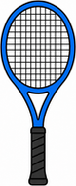
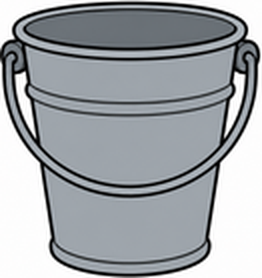

# Unit 1 The Great Outdoors — 第五回｜綜合複習 After School

姓名：________　座號：____　分數：____ / 100

## 一、聽力測驗

按「🔊 播放」聽句子（可重複聽），選出正確答案。

1. 🔊（老師播放）What is B going to do?
   (A) eat pizza with A　(B) go fishing　(C) play tennis　(D) do homework
2. 🔊（老師播放）Is B going to do homework?
   (A) B is doing it now.　(B) Yes, B is.　(C) B doesn't know.　(D) No, B isn't.
3. 🔊（老師播放）What does Gus have?
   (A) a bat and a mitt　(B) a skateboard　(C) a tennis ball and a tennis racket　(D) a bucket
4. 🔊（老師播放）What does B say?
   (A) B needs an umbrella.　(B) B doesn't know.　(C) B knows.　(D) B hopes it rains.
5. 🔊（老師播放）Who is he going to play with?
   (A) his brother　(B) Gus　(C) Sue　(D) May

## 二、是非題

閱讀短文，判斷句子是 True（對）或 False（錯）。

> Today after school, Gus is going to play tennis with May. He has a tennis racket and a tennis ball. Sue isn't going to play tennis. She is going to do her homework. The weather is going to be warm, so nobody needs an umbrella.

6. Gus is going to play tennis with Sue.　（ T / F ）
7. Gus has a racket.　（ T / F ）
8. Sue is going to do her homework.　（ T / F ）
9. The weather is going to be cold.　（ T / F ）
10. Everybody needs an umbrella.　（ T / F ）

## 三、選擇題

選出最適合的答案。

11. A: Are you going to play tennis with Gus?  B: ____
   (A) No, I don't.　(B) Yes, I do.　(C) Yes, he does.　(D) No, I'm not.
12. I'm going to eat pizza ____ you.
   (A) with　(B) for　(C) on　(D) at
13. A: What are you going to do after school?  B: I'm going to ____ my homework.
   (A) eat　(B) go　(C) play　(D) do
14. Ask the ____. He knows the weather.
   (A) mitt　(B) weatherman　(C) helmet　(D) bucket
15. The ____ says it's going to snow.
   (A) towel　(B) racket　(C) newspaper　(D) tent
16. What is this?  這是什麼？
   
   (A) a fishing rod　(B) a bat　(C) a bucket　(D) a tennis racket
17. What is this?  這是什麼？
   
   (A) a helmet　(B) a bucket　(C) a tennis ball　(D) a mitt

## 四、文法測驗

選出文法正確的答案。

18. ____ you going to play tennis with me today?
   (A) Do　(B) Am　(C) Are　(D) Is
19. I'm not going to study ____ Sue.
   (A) with　(B) for　(C) of　(D) at
20. Gus ____ a tennis racket.
   (A) has　(B) is　(C) have　(D) are
21. She is going to ____ her homework.
   (A) does　(B) did　(C) do　(D) doing
22. They ____ going to play baseball.
   (A) is　(B) are　(C) be　(D) am

## 五、配合題

左邊的題目要配右邊哪一個？用下拉選單選出代號。

- (A) Yes, he does.
- (B) I'm going to eat pizza.
- (C) No, I'm not.
- (D) It's going to snow.
- (E) I don't know.

23. Are you going to play tennis with Gus?　（　）
24. What are you going to do after school?　（　）
25. Do you think we need our umbrellas?　（　）
26. Does he need a helmet?　（　）
27. How's the weather going to be?　（　）

## 六、句子改寫

依照提示改寫句子，直接輸入完整句子（注意大小寫與標點可忽略）。

28. (改成疑問句) You are going to eat pizza with me.
   → ______________________________
29. (改成否定句) I'm going to do my homework today.
   → ______________________________
30. (主詞改成 She) I have a tennis racket.
   → ______________________________
31. (改成疑問句) He is going to play tennis with May.
   → ______________________________
32. (改成否定句) She needs a helmet.
   → ______________________________

## 七、句子重組

依序點選單字，排成正確的句子。

33. What / to / school / are / today? / going / you / after / do
   → ______________________________
34. going / to / pizza / you. / I'm / with / eat
   → ______________________________
35. play / going / he / May / today? / to / Is / tennis / with
   → ______________________________
36. a / He / racket. / has / tennis
   → ______________________________
37. brother. / play / video / my / I'm / with / going / to / games
   → ______________________________

---

## 聽力稿（老師用）

1. A: What are you going to do after school today? B: I'm going to eat pizza with you.
2. A: Are you going to do your homework with Sue today? B: No, I'm not. I'm not going to do my homework today.
3. Gus is going to play tennis. He has a tennis ball and a tennis racket.
4. A: Do you think we need our umbrellas? B: Ask the weatherman. I don't know.
5. A: Is he going to play tennis with May today? B: Yes, he is. He has a tennis racket.

## 答案

**一、聽力測驗**　1. A　2. D　3. C　4. B　5. D

**二、是非題**　6. F　7. T　8. T　9. F　10. F

**三、選擇題**　11. D　12. A　13. D　14. B　15. C　16. D　17. B

**四、文法測驗**　18. C　19. A　20. A　21. C　22. B

**五、配合題**　23. C　24. B　25. E　26. A　27. D

**六、句子改寫**　
- 28. Are you going to eat pizza with me?
- 29. I'm not going to do my homework today.
- 30. She has a tennis racket.
- 31. Is he going to play tennis with May?
- 32. She doesn't need a helmet.

**七、句子重組**　
- 33. What are you going to do after school today?
- 34. I'm going to eat pizza with you.
- 35. Is he going to play tennis with May today?
- 36. He has a tennis racket.
- 37. I'm going to play video games with my brother.
